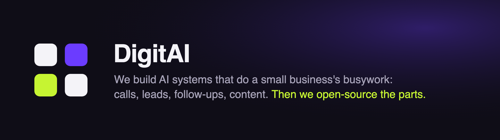

### Hi, we're DigitAI 👋

[**DigitAI**](https://digitai.co.il) is an AI studio in Israel. We find where a small business loses time and money
every month (missed calls, leads that wait, follow-ups done by hand, WhatsApp chaos) and build the AI system that does
that work. One build, owned by the business, no monthly retainer.

We run our own business on the same kind of agents: they write outreach, post content, research leads and answer the
phone. When a part is useful on its own, we clean it up and open-source it here.

### Open source

| Project | What it does |
|---|---|
| 📞 **CallBridge** · *launching soon* | An AI receptionist and sales caller on your **own** iPhone number. An ElevenLabs voice agent answers and makes real calls through your Mac and logs every call to Telegram, Slack, HubSpot or any CRM. Ships as a Claude Code plugin. |

### What we work with

`Python` · `TypeScript` · `Claude Code` & the Claude API · `ElevenLabs` · `Playwright` · `Appium` · `n8n` · `Meta & Google APIs` · `macOS automation`

### Find us

[Website](https://digitai.co.il) · [Instagram](https://www.instagram.com/digitai.co.il/) · [TikTok](https://www.tiktok.com/@digitai.coil) · [LinkedIn](https://www.linkedin.com/company/145410190/)

If something here saves you time, a ⭐ helps others find it.
